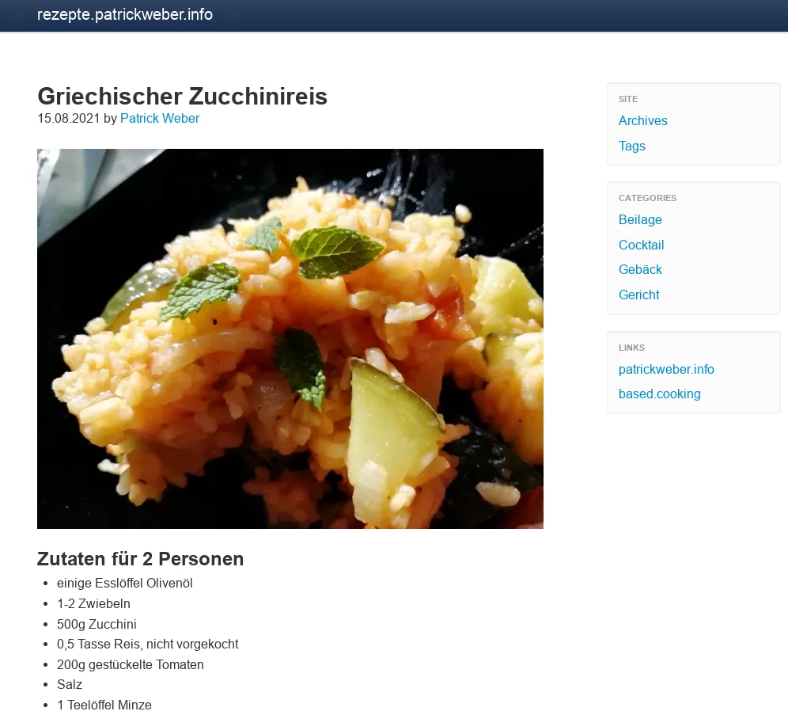

# Tuxlite_Recipes
A [Pelican](https://getpelican.com) theme based on [tuxlite_lbs](https://github.com/getpelican/pelican-themes/tree/master/tuxlite_tbs), modified to create simple and responsive recipes websites.

## Why this theme?
If you have ever looked up a cooking recipe on the net and felt annoyed by heaps of circumstantial information burying the essentials, tons of javascript and pictures bogging down page load speeds, then this theme is right up your alley.

This theme harnesses Pelican to create your personal recipes website on lightning fast rendering html, cutting right through the bullshit!

## Screenshot

## License
This project is licensed under the [MIT license](./LICENSE).
